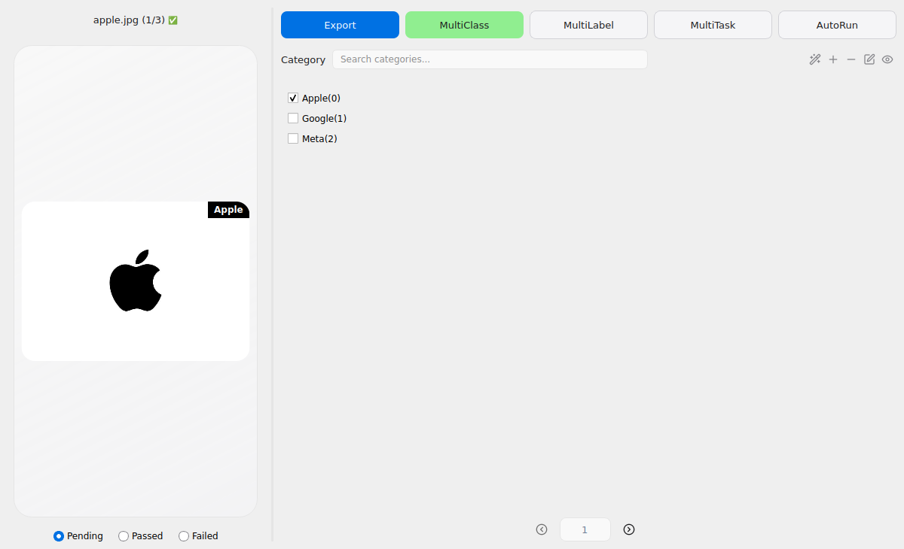
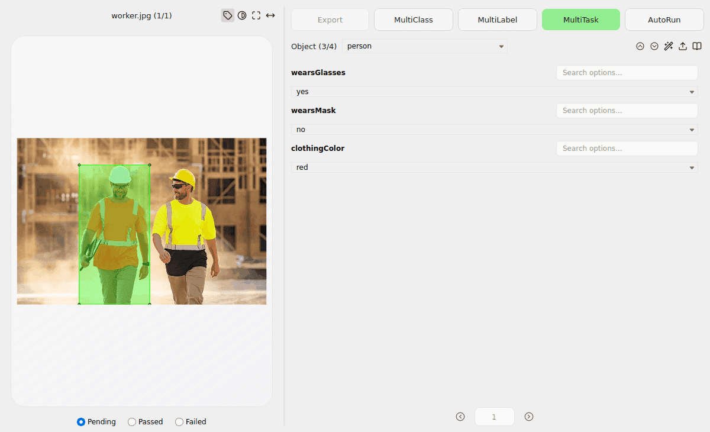
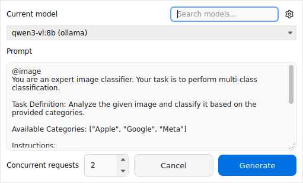

# 图像分类器

图像分类器提供三种标注模式：

| 模式 | 标注对象 | 用途 |
| --- | --- | --- |
| MultiClass | 整张图片 | 每张图片选择一个类别 |
| MultiLabel | 整张图片 | 每张图片选择多个类别 |
| MultiTask | 图片中的已有对象 | 为每个对象填写多个属性 |

## 启动与界面

先在主窗口加载图片目录，然后点击图像分类器图标，或使用 `Ctrl+3`（Windows/Linux）／`⌘+3`（macOS）打开。关闭分类器后会返回主窗口。



左侧显示图片和标注状态；右侧用于切换模式、编辑分类或属性，以及导航图片。状态栏中的 **Pending**、**Passed**、**Failed** 与主窗口的审核状态同步。

## 图像级分类

### 配置类别

在 MultiClass 或 MultiLabel 模式下，通过类别工具栏的添加按钮输入类别，每行一个；也可以从文本文件导入。类别搜索支持不区分大小写的关键词匹配，多个关键词以空格分隔，搜索不会改变已有选择。

### 标注与管理

选择 MultiClass 或 MultiLabel，在右侧勾选类别。MultiClass 一张图片只能选择一个类别；MultiLabel 可选择多个。从 MultiLabel 切换到 MultiClass 不会自动清理其他图片的多标签结果，请逐张复核。

类别工具栏还支持添加、删除、重命名和查看统计。删除或重命名类别会更新相关标注，请在操作前确认。也可以先在主窗口使用分类模型预标注，再打开分类器复核；模型列表见[图像级分类示例](../../examples/classification/image-level/README.md#model-assisted-classification)。

## 对象级多任务

### 准备对象和属性配置

先在主窗口标注或加载对象，然后切换到 **MultiTask**，点击对象选择框旁的上传图标，加载[属性 JSON 文件](../../examples/classification/shape-level/attributes.json)。配置中的类别名称必须与对象标签一致。例如：

```json
{
  "vehicle": {
    "bodyColor": ["red", "white", "blue"],
    "vehicleType": ["SUV", "sedan", "truck"]
  }
}
```

可通过 `__widget_types__` 配置下拉框、单选按钮、文本输入框或 `group_id` 选择框。完整格式见[对象级分类示例](../../examples/classification/shape-level/README.md)。加载的配置也可在主窗口使用。

### 选择对象并编辑属性

在下拉框中选择对象，或在预览中点击对象，即可编辑其属性。选择 **All objects** 查看整张图片；使用上一个、下一个按钮或 `Shift+A`、`Shift+D` 切换对象。双击对象或从下拉框选择对象可聚焦预览。



预览工具可显示标签、遮罩背景、适应窗口或宽度；也可通过滚轮缩放、拖动平移。适应快捷键使用主窗口配置，默认分别为 `Ctrl+F` 和 `Ctrl+Shift+F`。

## AI 辅助标注

### 配置模型

在 [Chatbot](./chatbot.md) 中配置可用的视觉语言模型。批量 AI 面板可搜索并选择模型、编辑提示词、设置并发数；齿轮按钮打开 Chatbot 设置，切换模型会同步到 Chatbot 当前配置。



### 处理当前图片

- **MultiClass / MultiLabel**：点击类别工具栏的 AI 图标，使用或编辑默认提示词，处理当前图片。
- **MultiTask**：加载属性配置后，点击 AI 图标处理选中对象；选择 **All objects** 时处理当前图片中已配置属性的所有对象。

多任务推理使用对象裁剪图、类别和属性配置。候选项结果必须匹配配置；无法判断的值可留空，`group_id` 不参与 AI 推理。批量提示词中的 `@object` 和 `@attributes` 会替换为对应对象的类别及属性配置。

### 批量自动运行

点击 **AutoRun**，选择起止图片；范围包含两端，默认从当前图片到最后一张。在 AI 面板确认模型和提示词，并设置 1～8 个并发请求（默认 2），点击 **Generate**。MultiClass / MultiLabel 处理整张图片，MultiTask 处理所选图片中已配置属性的对象。

生成前可确认覆盖提示，也可勾选 **Don't show again**。进度窗口支持取消并报告完成、跳过和失败数量；已完成的结果会保留。多任务批处理结束且有成功结果时，会选中当前图片的第一个对象；单对象推理保持原选择。请复核 AI 结果。

## 保存与导出

图像级分类存储在标注文件顶层的 `flags` 中，多任务属性存储在各对象的 `shapes[].attributes` 中，两者相互独立。当前图片的修改遵循主窗口自动保存设置；未开启时需返回主窗口手动保存。

批量处理其他图片时，结果直接写入标注文件。如果文件在处理期间被修改，该结果会跳过并报告失败；MultiTask 会跳过没有标注文件或没有对应属性配置的项。

**Export** 仅支持 MultiClass：它读取已保存的标注，将图片复制到 `classified/<类别>/` 目录，不改变原图。导出前请先保存当前修改。

## 快捷键

| 快捷键 | 功能 |
| --- | --- |
| `A` / `D` | 上一张 / 下一张图片 |
| `Ctrl+A` / `Ctrl+D` | 上一张 / 下一张未标注图片（图像级分类） |
| `0–9` | 选择或取消选择对应编号的图像类别 |
| `Shift+A` / `Shift+D` | 上一个 / 下一个对象（MultiTask） |
| `Ctrl+F` / `Ctrl+Shift+F` | 适应窗口 / 适应宽度（MultiTask，默认配置） |

macOS 上使用对应的 `⌘` 组合键。更多数据格式说明见[用户手册](./user_guide.md#14-保存标签数据)。
