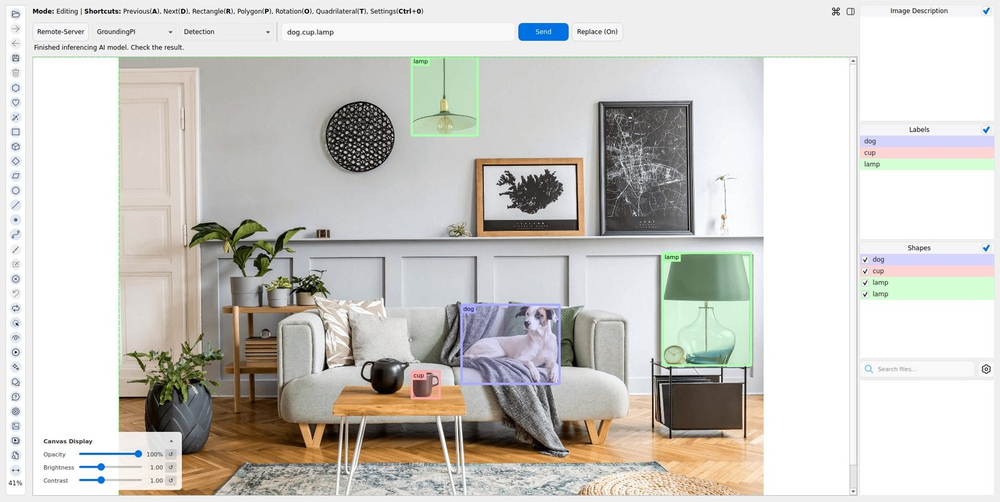
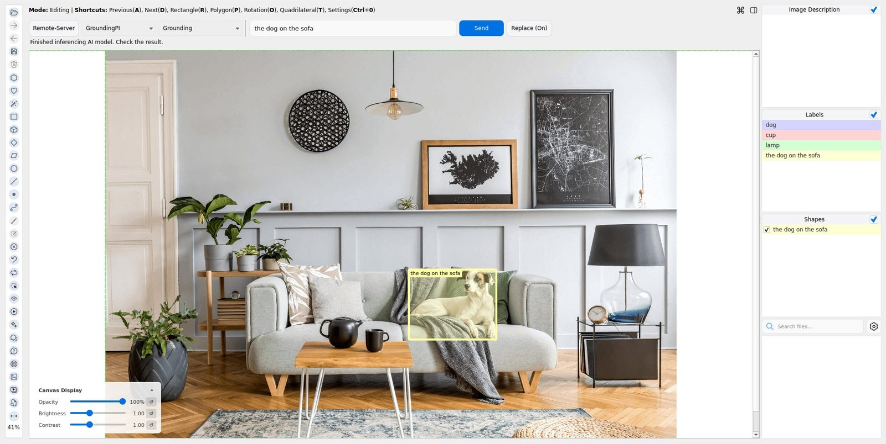
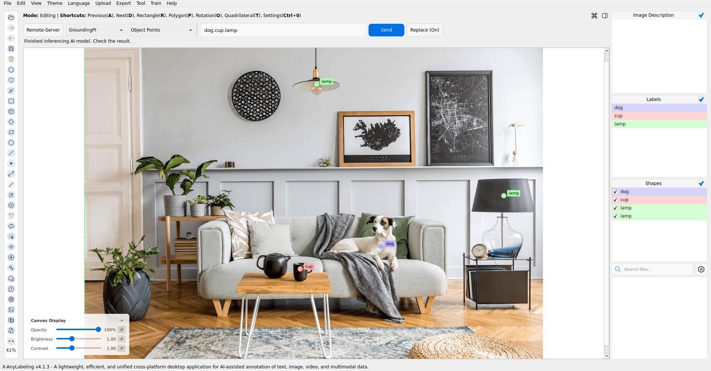
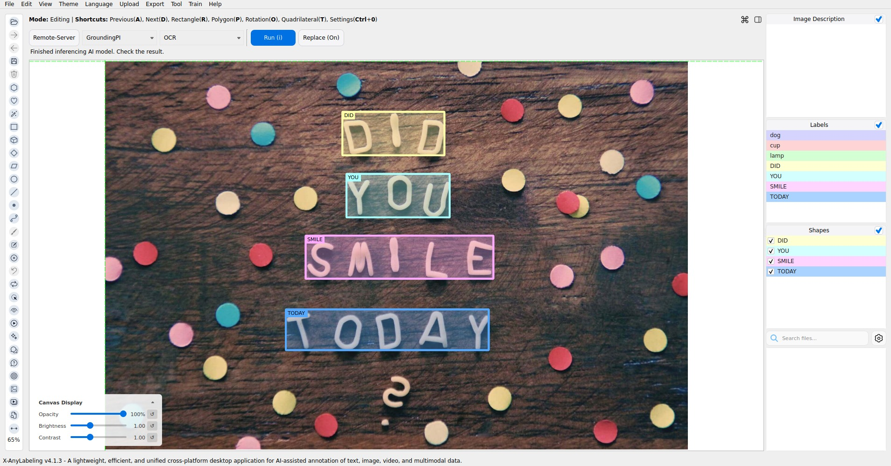
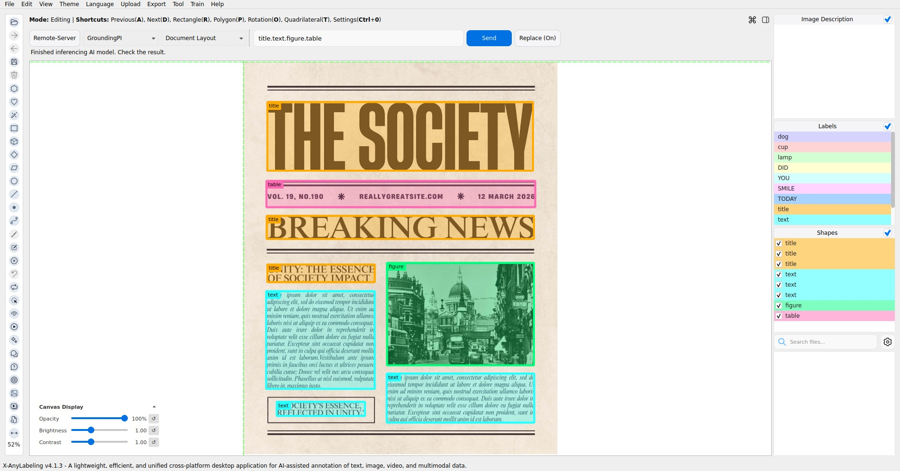
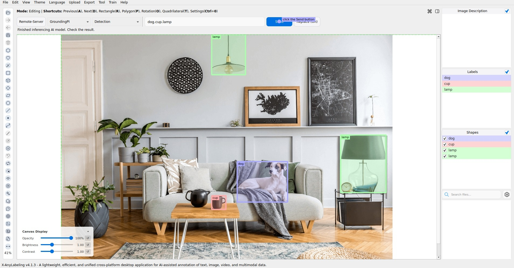
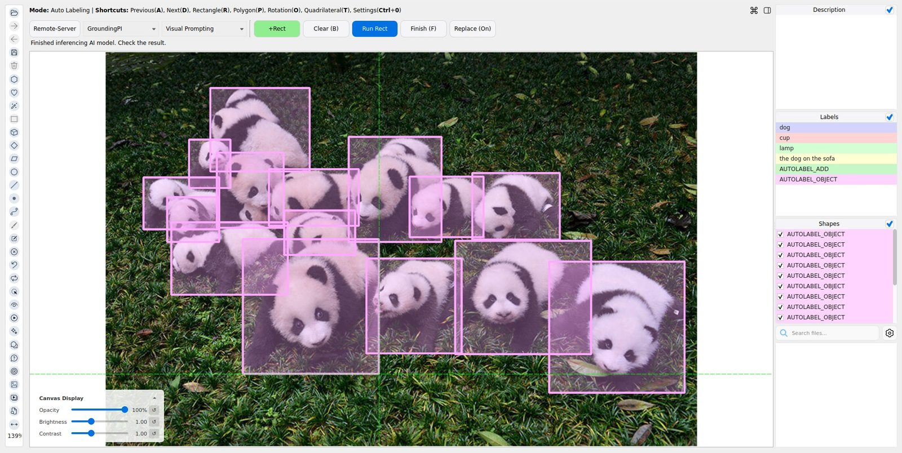

# GroundingPI, GroundAnything, and GroundAnything-VLM

## Overview

[GroundingPI](https://github.com/groundingpi/GroundingPI) is a 4B-parameter grounding foundation model designed to provide spatial perception for physical intelligence. It combines a visual encoder with a language backbone, using staged training on visual primitives and an autoregressive spatial-token format to represent object locations.

[GroundAnything](https://huggingface.co/GroundingPI/GroundAnything) and [GroundAnything-VLM](https://huggingface.co/GroundingPI/GroundAnything-VLM) are variants of the same family. GroundAnything replaces autoregressive spatial-token decoding with blockwise diffusion decoding, while GroundAnything-VLM predicts spatial tokens sequentially. All three models localize objects using category names, natural-language descriptions, or reference boxes, and use the same 0–999 coordinate grid for bounding boxes and points. The same spatial protocol covers scene text, document layout elements, and GUI click targets.

| Task | Input | Output |
| --- | --- | --- |
| Detection | Categories such as `dog.cup.lamp` | Labeled rectangles |
| Grounding | A description such as `the dog on the sofa` | Rectangles |
| Pointing | A description such as `the dog on the sofa` | Points |
| Object Points | Categories such as `dog.cup.lamp` | Labeled points |
| OCR | Image only | Rectangles labeled with recognized text |
| Document Layout | Categories such as `title.text.figure.table` | Labeled rectangles |
| GUI Grounding | An instruction such as `click the Send button` | A point on the UI element |
| Visual Prompting | Positive reference boxes | Rectangles around similar objects |

## Models

| Model | Model ID | Configuration | Decoding |
| --- | --- | --- | --- |
| GroundingPI | `groundingpi` | `configs/auto_labeling/groundingpi.yaml` | Autoregressive spatial tokens |
| GroundAnything | `groundanything` | `configs/auto_labeling/groundanything.yaml` | Blockwise diffusion with native self-speculation |
| GroundAnything-VLM | `groundanything_vlm` | `configs/auto_labeling/groundanything_vlm.yaml` | Autoregressive spatial tokens |

## Installation

Follow the X-AnyLabeling-Server installation guide ([English](https://github.com/CVHub520/X-AnyLabeling-Server/blob/main/docs/source/en/get_started.md) / [简体中文](https://github.com/CVHub520/X-AnyLabeling-Server/blob/main/docs/source/zh_cn/get_started.md)), including the shared GroundingPI requirements. 

Enable the desired models in `configs/models.yaml`:

```yaml
enabled_models:
  - groundingpi
  - groundanything
  - groundanything_vlm
```

Set `model_path` to the corresponding Hub ID or a downloaded model directory, and select the device in the model configuration. Enable one model at a time if GPU memory is limited.

GroundAnything uses the upstream native self-speculative decoder: diffusion drafts are verified by the same checkpoint's causal branch. GroundingPI and GroundAnything-VLM use standard autoregressive generation. No separate inference service is required. The SGLang entropy-guided decoder and its benchmark speedups are not part of this native integration.

## Usage

Open an image, press `Ctrl+A`, select **Remote-Server**, connect to your Server, and choose **GroundingPI**, **GroundAnything**, or **GroundAnything-VLM**. All three models use the same controls.

### Detection

Enter categories such as `dog.cup.lamp` and click **Send**. Periods, commas, newlines, and mixed separators are supported; duplicate categories are removed while preserving their order.



### Grounding

Enter a complete description such as `the dog on the sofa` and click **Send**. The description is kept as one phrase, including its internal punctuation.



### Pointing

Enter a description and click **Send** to create point annotations instead of boxes.


### Object Points

Select **Object Points**, enter categories such as `dog.cup.lamp`, and click **Send**. This task locates instances of each category as points. **Pointing** instead takes a complete description of a target. Category separators follow the Detection rules.



### OCR

Select **OCR** and click **Run** without entering a text prompt. Each detected text region becomes a rectangle labeled with its recognized text.



### Document Layout

Select **Document Layout**, enter layout categories such as `title.text.figure.table`, and click **Send**. Category separators follow the Detection rules. Results are rectangles labeled with layout categories.



### GUI Grounding

Open a screenshot, select **GUI Grounding**, enter an instruction such as `click the Send button`, and click **Send**. The result is a point annotation on the requested UI element; it does not perform a click. Instructions are kept as complete phrases.

To export the annotated screenshot, select **Tool → Save Visualization Image**, choose **Current Frame**, check **point** and **Save Labels**, and save the image. This exports the input screenshot with its predicted point, without including the surrounding annotation window.



### Visual Prompting

Click **+Rect**, draw a positive reference box around an example object, and click **Run Rect** to find similar objects. Click **Finish** and enter a label, such as `panda`, to name the results. **Clear** removes unfinished prompt marks while retaining finished annotations.



Use **Replace (On)** / **Preserve (On)** to control whether predictions replace existing annotations. Detection, Grounding, Pointing, Object Points, Document Layout, and GUI Grounding support text-prompt batch processing: open an image folder, choose the task, click **Auto Run**, select the image range, and enter the prompt. OCR supports **Auto Run** without a text prompt. Visual Prompting requires per-image reference boxes and does not support batch processing.

## Notes

- Coordinates are converted from the shared 0–999 grid to original image pixels. Confidence scores and confidence/IoU controls are not provided.
- All three models can return false positives for absent targets. In the demo image, an `elephant` query returned a box even though no elephant was present. Review predictions before accepting annotations.
- Review recognized text and GUI target locations. Small UI icons can be confused with nearby controls, and OCR can misread individual characters.
- These adapters expose the eight tasks above. Segmentation, negative reference boxes, input point prompts, and video are not exposed.
- Truncated or malformed generations are rejected. Adjust `max_new_tokens` and available GPU memory for dense scenes.
