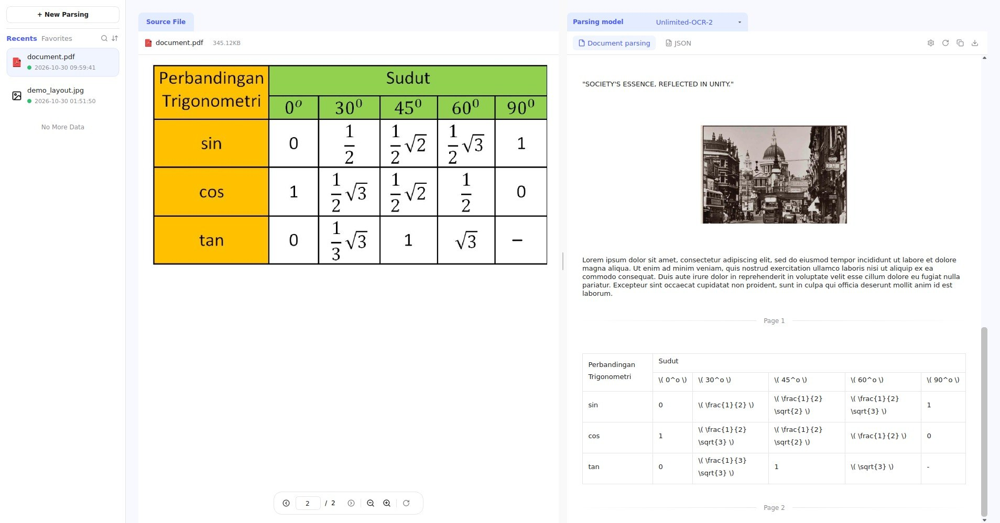

# Unlimited-OCR-2

## Overview

[Unlimited-OCR-2](https://huggingface.co/baidu/Unlimited-OCR-2) parses document images into layout blocks with categories, coordinates, and recognized content. Its Sparse Reference Sliding Window Attention (SR-SWA) supports long-document decoding by maintaining a bounded set of working references. Multi-page inference uses ordered pages in one document request, retaining cross-page context and continuation relationships for text and tables.

## Installation

Follow the X-AnyLabeling-Server installation guide ([English](https://github.com/CVHub520/X-AnyLabeling-Server/blob/main/docs/source/en/get_started.md) | [简体中文](https://github.com/CVHub520/X-AnyLabeling-Server/blob/main/docs/source/zh_cn/get_started.md)). Install the `unlimited_ocr_2` extra for native Transformers inference, or the `unlimited_ocr_2_sglang` extra in the SGLang serving environment. These backends require different Transformers versions.

Enable `unlimited_ocr_2` in the Server's `configs/models.yaml`. Configure the backend in `configs/auto_labeling/unlimited_ocr_2.yaml`:

- `backend: transformers`: loads the pinned Hugging Face weights locally; `model_path` also accepts a local snapshot directory.
- `backend: sglang`: connects to the customized upstream SGLang service through `api_url`. Set `served_model` to its served model name. An optional key can be supplied through `SGLANG_API_KEY` or `api_key`.

For SGLang deployment and page-window settings, see the [Server deployment guide](https://github.com/CVHub520/X-AnyLabeling-Server/blob/main/docs/source/en/unlimited_ocr_2.md).

## Usage

1. Configure the X-AnyLabeling remote server address to point to X-AnyLabeling-Server.
2. Open the **Document Parser** (`Ctrl+4`) and select **Unlimited-OCR-2** in **Parsing model**. This model uses the document panel, not the main-window annotation workflow.
3. Click **+ New Parsing**, select an image or PDF, and start parsing. The client renders PDF previews locally, then sends all pages in order in one document request. It does not run independent inference on each page.
4. Review the source page and structured content side by side. Use the page controls to navigate PDFs and select blocks to inspect their source regions.
5. Correct individual blocks, copy recognized content, or export the document/JSON using the panel's existing controls. The JSON preserves page geometry and global group IDs for cross-page continuation blocks.

## Notes

- Both Transformers and SGLang support joint multi-page requests. SGLang also supports long-document page windows with retained context between windows; the adapter consumes its streaming response and checks completion and page count before saving results.
- `max_new_tokens` is the output budget **per input page**; the adapter multiplies it by the document's page count. A truncated response is reported as an error. `crop_mode: null` uses tiling for one page and base mode for multi-page input; `true` or `false` explicitly selects either mode.
- The native backend is bounded by `max_model_len` and available GPU memory. Long documents should use the SGLang page-window scheduler. Window size affects memory use and how much cross-page context can be retained.
- The panel's remote document timeout defaults to 3600 seconds and can be configured with `remote_server_settings.document_timeout`. Cancelling stops client-side waiting; inference already running on the server may continue.
- Recognition quality depends on the input. For example, the upstream native model reads the handwritten `E` in the formula demo as `S`; the integration does not silently rewrite model predictions.
