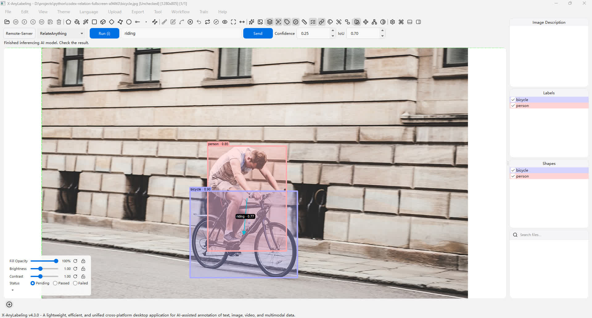

# RelateAnything

## Overview

[RelateAnything](https://github.com/Maelic/RelateAnything) predicts open-vocabulary relations between object regions in an image. It combines visual features for pairs of regions with embeddings of relation phrases to rank directed subject–relation–object triplets. Object regions are provided by a separate detector.

## Installation

Follow the X-AnyLabeling-Server [English](https://github.com/CVHub520/X-AnyLabeling-Server/blob/main/docs/source/en/get_started.md) or [Chinese](https://github.com/CVHub520/X-AnyLabeling-Server/blob/main/docs/source/zh_cn/get_started.md) setup guide. Enable `relateanything` and configure its detector, model, and device in `configs/auto_labeling/relateanything.yaml`.

## Usage

1. Connect to the server and select **Remote-Server** and **RelateAnything** in the AI panel.
2. Select **Run** to detect objects and predict relations with the default vocabulary. To use a custom vocabulary, enter comma-separated phrases such as `riding, beside, in front of` and select **Send**.
3. Each directed arrow connects a subject to an object. Its label and confidence follow the Show Labels and Show Scores controls. Click a relation label to select it; the connected objects and arrow are highlighted, while other relations fade. Its four handles indicate selection and cannot be dragged. Press **Delete** to remove the selected relation, or double-click the selected label to edit or delete it. A manually changed relation no longer has a model confidence score.
4. To add a relation yourself, select exactly two shapes, then choose **Create Relation** from the toolbar, canvas context menu, or Edit menu. Confirm the subject and object and enter a relation name. Use **Manage Relations** in either menu to review and edit relations in a list, including overlapping arrows; selecting a list item previews its objects on the canvas. Save the annotations as usual.

## Examples

## Notes

- Relations are stored in the annotation JSON as a top-level `relations` list. Each item contains `subject_id`, `object_id`, `label`, and `score`; IDs refer to the corresponding shapes' `shape_id` values. Relations are distinct from KIE links.
- The confidence and IoU controls affect object detection. Relation predictions use the separate `relation_threshold` setting in the server configuration (default `0.25`); only relations at or above it are returned. The number of boxes and returned relations can also be configured on the server; the default is the top five relations. Batch processing is not supported for this model.
- This workflow uses detector boxes; it does not use existing annotations as input. Review the boxes and relations before saving. Replacing existing annotations removes relations whose endpoints were replaced.
- Upstream code is AGPL-3.0-only with additional attribution terms; the model weights have separate DINOv3 terms. Review the [upstream license](https://github.com/Maelic/RelateAnything#license) before use.
