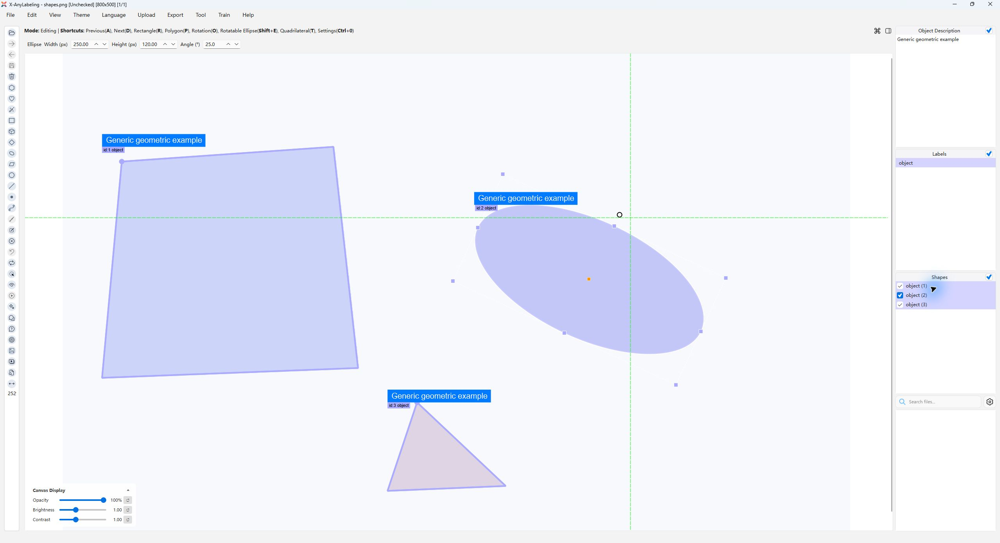

# Editable rotatable ellipses

[简体中文](README_zh-CN.md)

Open `shapes.png` to load a generic quadrilateral, native ellipse and polygon.
Select the ellipse to show its eight resize handles, independent rotation
handle and numeric full-width/full-height/angle controls.



## Drawing and editing

- Use **Shift+E**, then drag the control-box diagonal or click its two ends.
- Drag a corner or edge-midpoint handle to resize. Shift-drag a corner to keep
  the axis ratio. The opposite handle stays fixed.
- Drag the circular rotation handle. Shift snaps the **final width-axis angle**
  to multiples of 15 degrees, regardless of the initial click offset.
- Enter numeric values and finish editing to commit once; Escape cancels
  uncommitted input. A completed drag or numeric commit is one undo operation.
- Copy, paste, duplicate and undo retain a live ellipse editing target.
  Locked or hidden shapes cannot be changed with these controls.

The existing application settings still determine labeling dialogs,
automatic saving, language and switching to edit mode. Ellipses do not change
automatic-model output types or the existing replace/append policy.
Brush refinement, vertex editing and contour union require an explicit
**ellipse → polygon** conversion in the Shape Converter first.

## Approximation settings

The Canvas settings page exposes **Ellipse Polygon Points**, default **128**,
range **12–512**. It controls preview, segmentation export, Shape Converter
and built-in Segment data preparation. It does not rewrite native geometry.

```yaml
canvas:
  ellipse:
    polygon_points: 128
```

The CLI uses the same application configuration loader, including the early
`convert` subcommand. An explicit option overrides the selected configuration;
otherwise the configuration overrides the factory value 128.

```bash
python -m anylabeling.app convert --task xlabel2yolo --mode segment \
  --images examples/rotatable_ellipse \
  --classes examples/rotatable_ellipse/classes.txt \
  --output /path/to/separate/ellipse-yolo \
  --ellipse-polygon-points 128
```

Use `--config /path/to/application.yaml` to select a config file or
`--work-dir /path/to/settings` to select the usual user settings directory.
The count is also accepted when launching the GUI. Booleans, fractional
numbers, strings in YAML, and values outside the range fail validation.

## Native data contract

`shape_type: "ellipse"` contains exactly four ordered rectangular-frame
corners. At zero angle they are local top-left, top-right, bottom-right and
bottom-left; rotation retains that local order. The first edge is the full
width axis, and the fourth edge from the first point is the full height axis.
Width need not be the major axis. Near-circles never swap axes automatically.

Image x points right and y down. `direction` is clockwise width-axis radians
in `[0, 2π)`; numeric controls display degrees. A 180-degree rotation retains
its parameter direction even though the ellipse contour is geometrically
equivalent. Center, full axes and angle come from the corners, never from
separately persisted handles or cached parameters.

An explicitly stored direction must be a finite number, excluding booleans.
Missing direction is derived; finite stale direction is corrected from the
corners with a file/object warning. Loading alone does not save the input.
Unknown object metadata remains intact. Valid native r4 JSON is accepted;
older X-AnyLabeling builds without the ellipse type cannot necessarily read it.

Frames require positive local order, orthogonal axes, consistent opposite
edges/diagonal midpoints and full axes of at least one pixel. Frame position
tolerance is `1e-6 + 1e-6 * max(width, height)` pixels and normalized
orthogonality tolerance is `1e-6`; the one-pixel limit allows `1e-9` numerical
roundoff. Invalid frames are rejected rather than reordered or fitted.
Control-frame corners outside the image are not sufficient to reject a valid
represented ellipse.

## Format compatibility

| Format or entrypoint | Ellipse behavior |
| --- | --- |
| Native XLABEL JSON | Four editable frame corners, direction and metadata |
| YOLO Seg | Sampled, clipped, normalized polygon |
| COCO segmentation | Polygon segmentation; existing category/group policy retained |
| VOC segmentation | Existing **polygon XML extension**, not standard VOC detection XML |
| MASK grayscale/RGB | Shared contour, existing layer order and class priority |
| Class/instance mask helpers | Ellipse contour, never a filled control rectangle |
| Existing MOTS export | Existing `custom_gt.txt` intermediate; **not standard MOTS RLE** |
| Built-in Segment data preparation | Same contour, count and category mapping |
| Detection, OBB, pose, OCR and other incompatible exports | Explicit preflight error; no automatic bounding-box conversion |

Ellipses are sampled before intersection with the continuous image rectangle
`[0, width] × [0, height]`. Clipping can change the vertex count; repeated
adjacent points and redundant clipped edges are removed. Fully outside or
zero-area clipped results fail preflight. Pixel masks still use valid pixel
indices and the existing rasterization conventions. Qt antialiasing need
not match mask pixels exactly.

Existing polygon behavior is retained. Newly supported quadrilaterals use
the legacy polygon rule: clamp vertices to `[0, width−1] × [0, height−1]`,
retain order, and reject invalid/degenerate results. An in-bounds
quadrilateral still has four vertices. This deliberate compatibility rule
differs from the new ellipse clipping rule.

For COCO, pure legacy-polygon instances retain upstream raster-area and
pixel-grid bbox semantics. Instances containing an ellipse or newly supported
quadrilateral use the union of their actual exported polygons for continuous
area and bbox, retaining the existing `(label, group_id)` grouping and ignore
policy. MASK retains class-priority ordering followed by annotation layers.

External segmentation imports stay polygons. A segmentation round trip
cannot recover the native axes, angle or original control frame. The explicit
native Shape Converter samples the full ellipse without image clipping,
retains object metadata, and removes `direction`.

## Precision and output safety

Uniform parameter sampling is an approximation. Its unclipped polygon/ellipse
area ratio is `N * sin(2π/N) / (2π)`, independent of axis ratio or rotation.
Expected area losses are about 4.507% at 12 vertices, 0.1606% at 64, 0.04015%
at 128, and 0.002510% at 512. Coarse sampling can lose a very small visible
boundary cap; increase the count when the clipped result is degenerate.

All selected native inputs are preflighted before any output is replaced.
Output directories are merged, never cleared first. Related source hashes
are checked again before a complete same-directory temporary file replaces
its destination. Failed writes retain old outputs. Cancellation retains
completed files and leaves unprocessed destinations intact; it is **not a
batch rollback**. Multi-file formats have per-file, not group atomicity.
GUI/CLI reports distinguish success, failure, skipped and unprocessed inputs.
CLI cancellation exits nonzero. Choose a separate output directory.

The sample is synthetic and contains no model weights or dataset-specific
training assumptions. See [validation](../../docs/en/rotatable_ellipse_validation.md)
for executed checks and platform limitations.
