# WeVisOne-VL

## Overview

[WeVisOne-VL](https://github.com/Tencent/WeVisOne-VL) unifies object-level and pixel-level perception through structured next-token prediction. Coordinate tokens represent boxes and points, while a lightweight 9.6M-parameter decoder combines object-token states, boxes, and visual features to recover masks and continuous alpha mattes. The model covers detection, referring localization, counting, pointing, OCR, segmentation, and promptable matting, including absent-target responses.

| Task | Input | Output |
| --- | --- | --- |
| Object Detection | Category list | Labeled boxes |
| Referring Localization | Natural-language expression | Boxes |
| Pointing | Category or expression | Points |
| Counting with Boxes / Points | Category or expression | Boxes / points and count in the image description |
| OCR | Image | Recognized text as box labels |
| Text Grounding | Text to find | Text boxes |
| Text Segmentation | Category or expression | Polygons and binary mask PNGs |
| Text Matting | Category or expression | Polygons, alpha PNGs, and transparent RGBA cutouts |
| Box Matting | Positive boxes | Polygons, alpha PNGs, and transparent RGBA cutouts |
| Visual Prompting | Reference boxes | Similar-object boxes |
| Freeform | Instruction | Text and any predicted boxes, points, or masks |

## Installation

Follow the X-AnyLabeling-Server installation guide ([English](https://github.com/CVHub520/X-AnyLabeling-Server/blob/main/docs/source/en/get_started.md) / [中文](https://github.com/CVHub520/X-AnyLabeling-Server/blob/main/docs/source/zh_cn/get_started.md)), including the `wevisone_vl` dependency extra.

Enable `wevisone_vl` in `configs/models.yaml`. Its configuration is `configs/auto_labeling/wevisone_vl.yaml`; the default checkpoint is `tencent/WeVisOne-VL-2B`. A local checkpoint directory is also accepted.

## Usage

Open the AI panel, choose **Remote-Server**, connect to your server, and select **WeVisOne-VL**.

- Select a text task, enter your prompt, and click **Send**. Detection accepts comma-, period-, or newline-separated categories such as `dog,plant`. Referring and pointing prompts preserve the complete expression, for example `the dog on the sofa`.
- For counting, enter a category such as `plants`; the image description contains the number of returned annotations. For **OCR**, click **Run** without a prompt. For **Text Grounding**, enter the exact text to locate, such as `TODAY`.
- For **Text Segmentation** or **Text Matting**, enter `dog` or a referring expression. The contour fineness slider adjusts polygon simplification; `mask_threshold` in the server configuration controls the contour threshold.
- For **Box Matting**, draw positive boxes around the foreground and click the rectangle run button. For **Visual Prompting**, draw reference boxes around example objects and run. Use **Finish** to name the returned objects; **Clear** removes prompts.
- **Freeform** accepts instructions such as `Describe this image.`. The image description shows natural-language output with coordinate tokens and markup removed.
- Enable **Preserve existing annotations** to retain previous shapes. Text tasks support text-prompt batch processing, OCR supports ordinary batch processing, and reference-box tasks disable batch processing.

After matting, the upper-right result thumbnail shows the transparent foreground. Click it to open a larger preview. Multiple foreground instances are combined in `preview.png`; individual alpha maps and cutouts are also retained. The preview follows the current image, model, and task during the session.

Segmentation and matting exports are saved beside the source image in a new `<image_stem>_outputs_*` directory for every request. The application log records the directory. Binary masks preserve holes that exterior polygon contours cannot represent; alpha PNGs retain continuous opacity at 8-bit precision, and cutouts retain the original RGB pixels with that alpha channel. Unsaved input images use a temporary output directory.

## Examples

### Object Detection

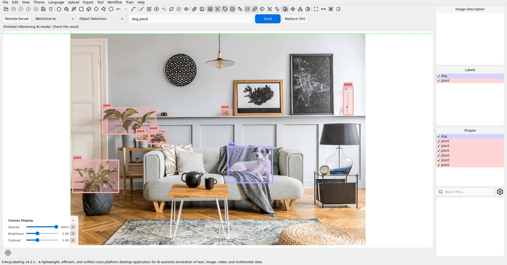

### Referring Localization

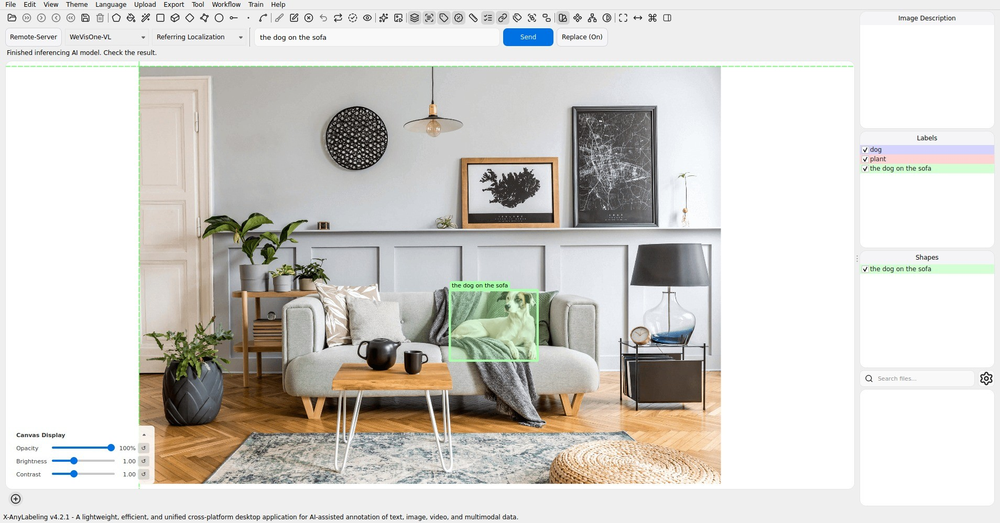

### Pointing

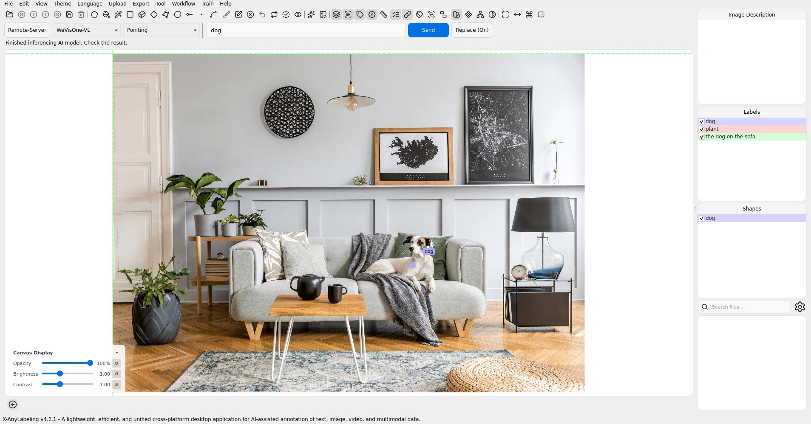

### Counting with Boxes

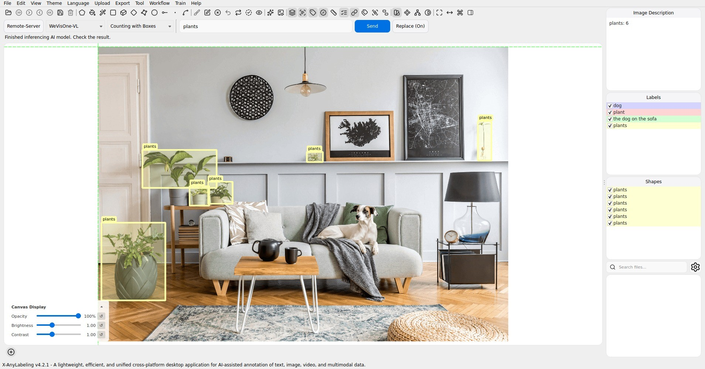

### Counting with Points

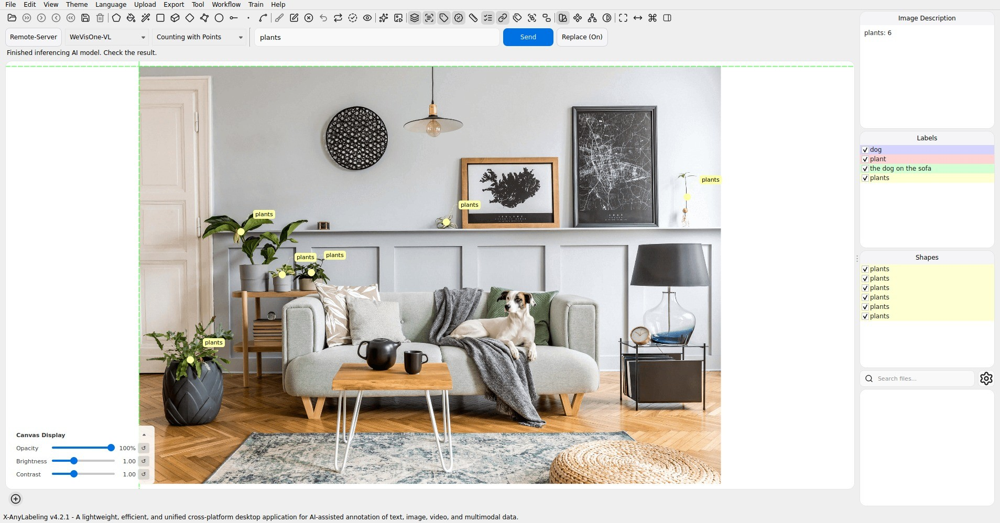

### OCR

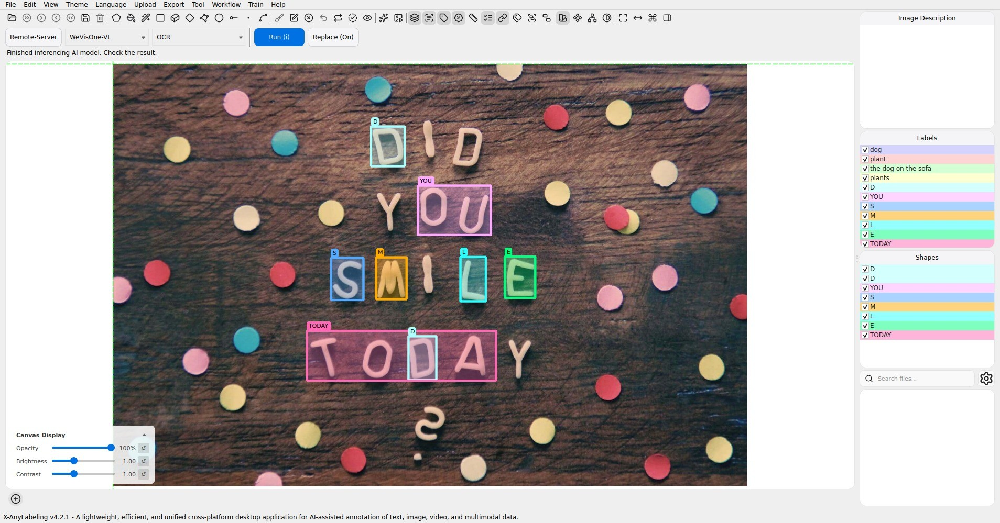

### Text Grounding

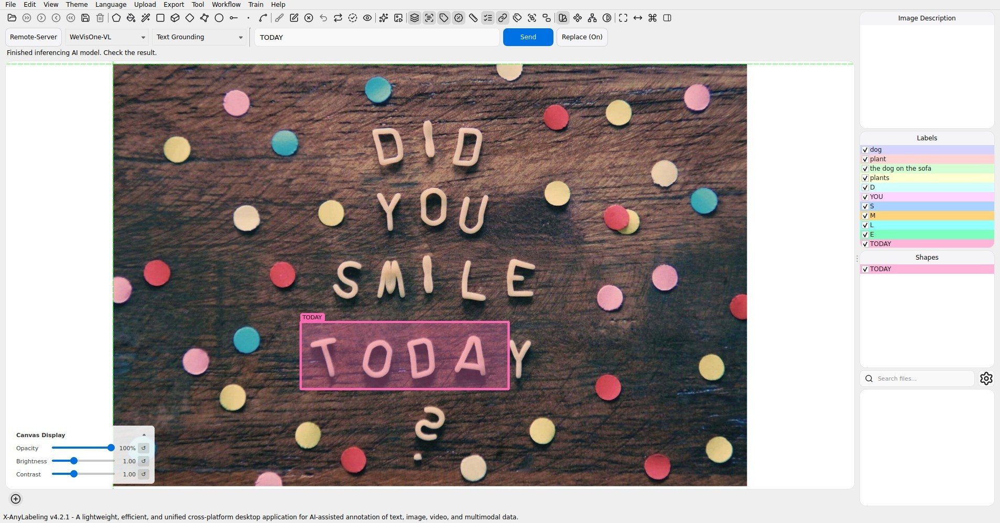

### Text Segmentation

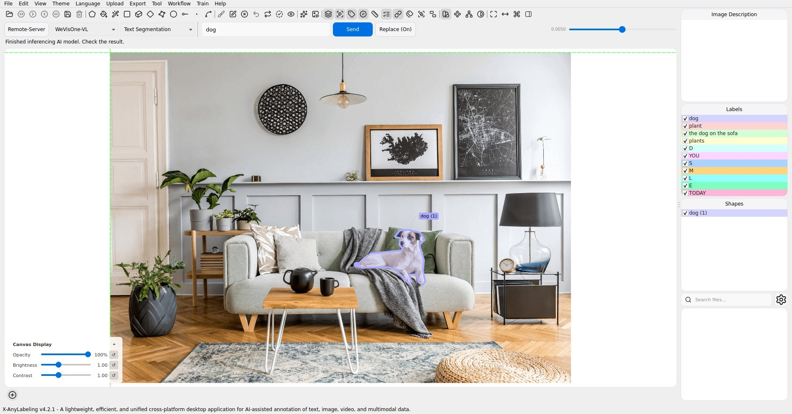

### Text Matting

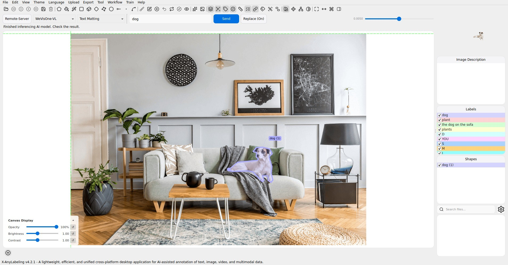

### Box Matting

### Visual Prompting

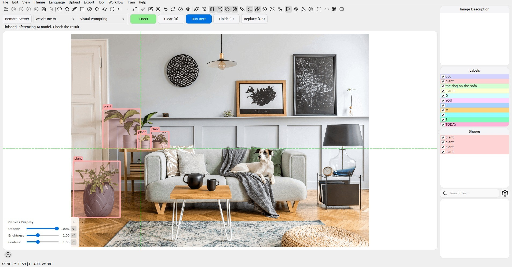

### Freeform

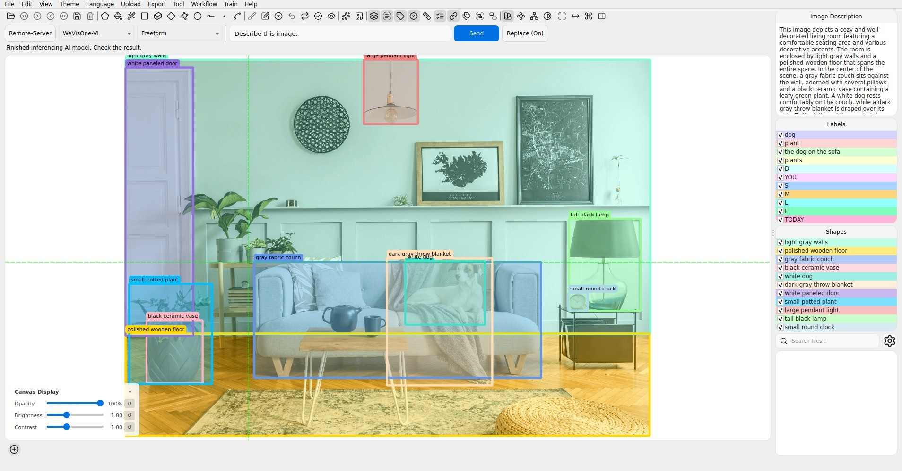

## Notes

The integration uses the Transformers backend. Model predictions may miss objects, misread text, or produce inaccurate counts; inspect the annotations before accepting them. No confidence or IoU controls are exposed because the model generates structured tokens rather than calibrated detection scores.
