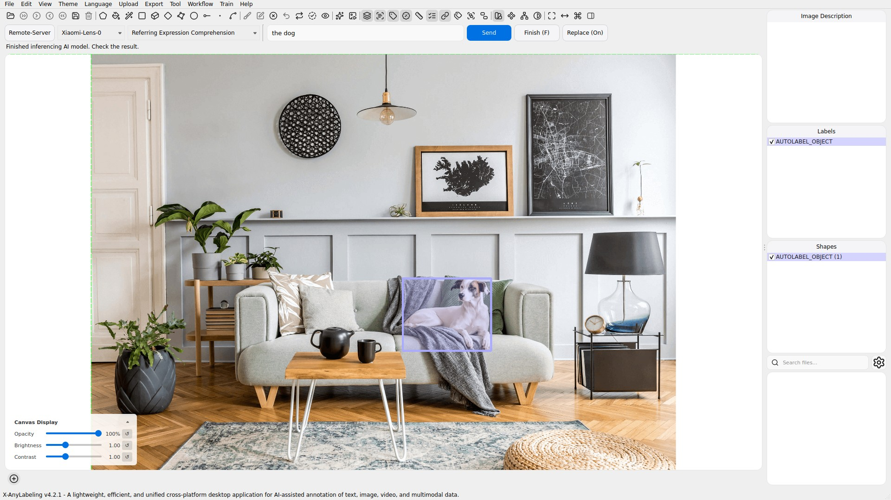
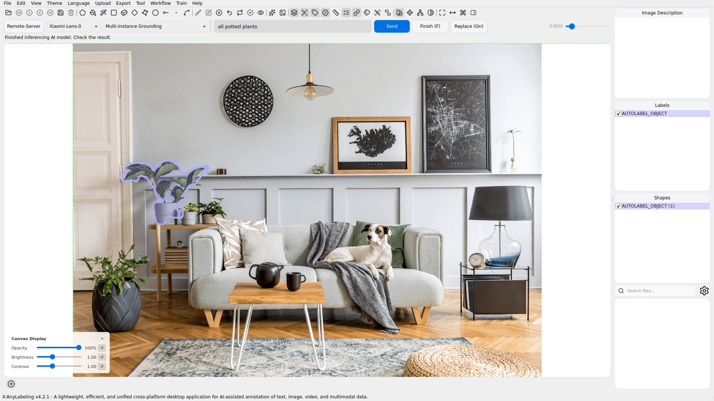
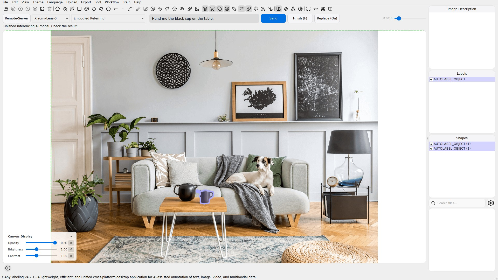
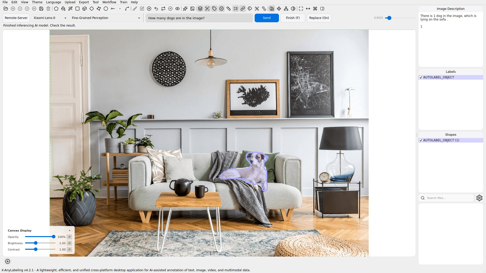

# Xiaomi-Lens-0

## Overview

[Xiaomi-Lens-0](https://huggingface.co/SeerRay-Lab/Xiaomi-Lens-0) is a multimodal model built on Qwen3.5-4B. Joint language and pixel-mask supervision teaches it to associate generated mask tokens with image regions. A lightweight decoder converts the contextual states of those tokens and shared vision features into segmentation masks. It supports referring expressions, implicit requests, embodied instructions, and visual questions, including counting. See the [upstream repository](https://github.com/SeerRay-Lab/Xiaomi-Lens-0) for the model and inference implementation.

| Task | Input | Output |
| --- | --- | --- |
| Referring Expression Comprehension | A target description | Bounding boxes |
| Referring Expression Segmentation | A target description | Polygons |
| Multi-Instance Grounding | A description such as `all potted plants` | Polygons for predicted regions |
| Reasoning Segmentation | An implicit request or question | Polygons and any final-answer text |
| Embodied Referring | An instruction identifying a target | Polygons and any final-answer text |
| Fine-Grained Perception | A visual question | Answer text and any final-answer polygons |

## Installation

Follow the X-AnyLabeling-Server installation guide ([English](https://github.com/CVHub520/X-AnyLabeling-Server/blob/main/docs/source/en/get_started.md) / [简体中文](https://github.com/CVHub520/X-AnyLabeling-Server/blob/main/docs/source/zh_cn/get_started.md)), including the `xiaomi_lens` dependency extra.

Enable `xiaomi_lens` in the Server model list. Its configuration is `configs/auto_labeling/xiaomi_lens.yaml`; `model_path` accepts `SeerRay-Lab/Xiaomi-Lens-0` or a local checkpoint directory.

## Usage

Connect to the service, open an image, and select **Remote-Server → Xiaomi-Lens-0** in the AI panel. Select a task, enter a complete description or instruction, and click **Send**. Punctuation is preserved; the input is not split into a class list.

Try these prompts with the living-room demo image:

- **Referring Expression Comprehension / Segmentation:** `the dog`
- **Multi-Instance Grounding:** `all potted plants`
- **Reasoning Segmentation:** `What can be used to pour tea?`
- **Embodied Referring:** `Hand me the black cup on the table.`
- **Fine-Grained Perception:** `How many dogs are in the image?`

Use **Finish** to name the predicted regions. Each decoded mask has a group ID; disconnected contours from the same mask share that ID. Adjust mask fineness for polygon detail, and use the preserve-annotations toggle to retain existing labels. All six tasks expose text-prompt batch processing.

Only final-answer regions become annotations. Intermediate reasoning masks are excluded. Answer text is stored in the image description; bounding-box and mask markup is removed.

### Referring Expression Comprehension

### Referring Expression Segmentation

### Multi-Instance Grounding

### Reasoning Segmentation

### Embodied Referring

### Fine-Grained Perception

## Notes

- Image inputs are supported. The upstream inference path does not support video, point prompts, or box prompts.
- Predictions can miss targets, combine multiple targets into one mask, or identify a region even when the requested target is absent. Multi-instance grounding does not guarantee one mask per object. Review generated annotations.
- Polygons represent external mask contours; holes are not encoded.
- `max_pixels` controls image processing resolution. Raising it can help small-object detail but increases memory use. `max_new_tokens` limits generation; truncated output raises an error instead of applying incomplete annotations.
